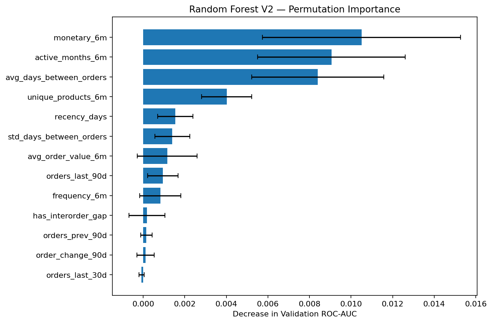
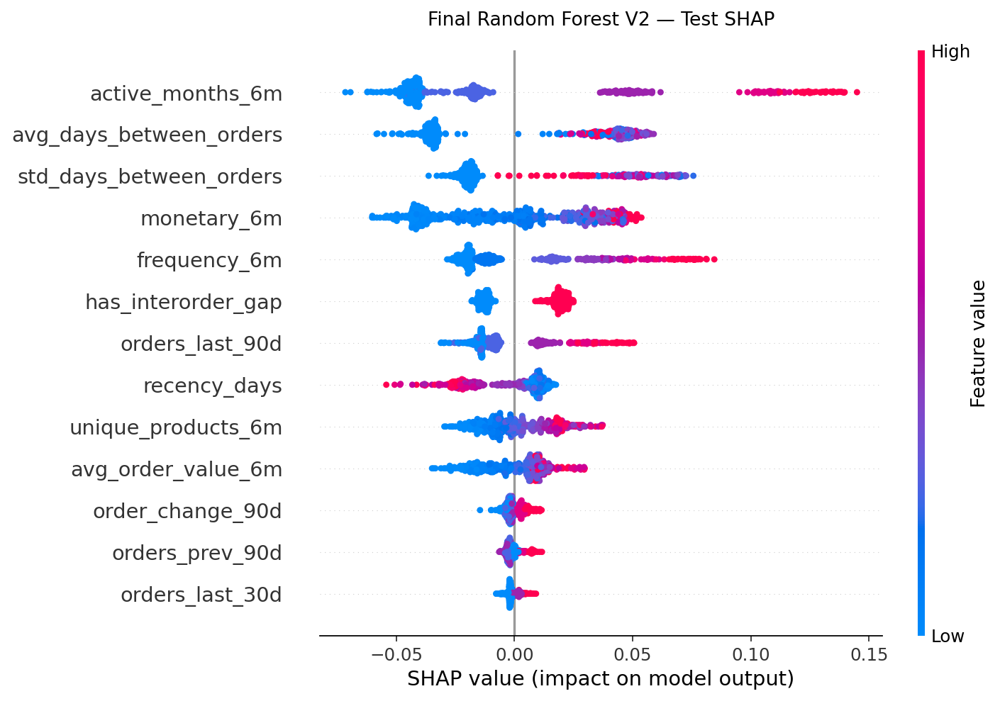
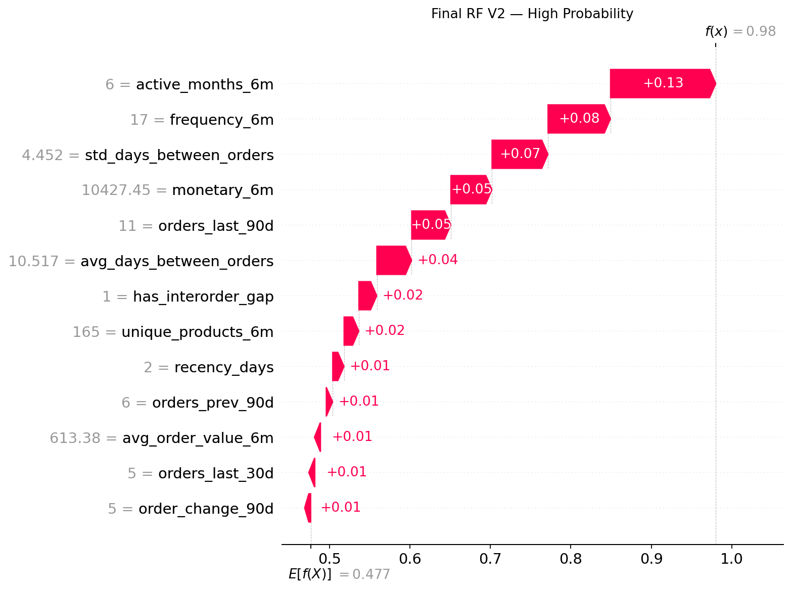
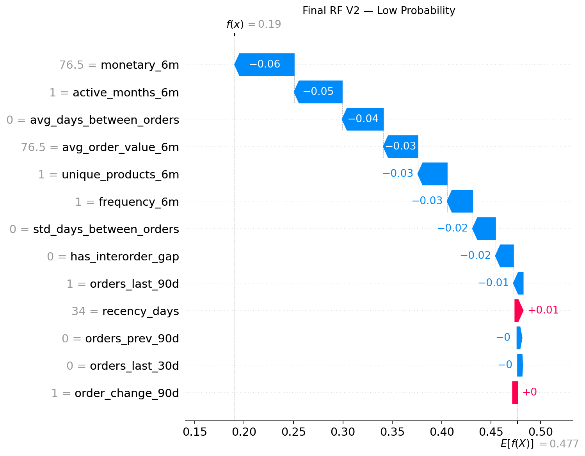

# E-commerce Customer Repurchase Prediction & Analytics

**Predicting three-month customer repurchase from historical transactions with SQL, temporal validation, and interpretable machine learning.**

This end-to-end data science portfolio project uses the **UCI Online Retail II** dataset to predict whether an eligible customer will place at least one qualifying positive-purchase order in the **next three calendar months**. The workflow covers transaction-quality investigation, customer–snapshot dataset construction in MySQL, feature engineering, model comparison, out-of-time evaluation, and customer-prioritization analysis.

> **Scope:** “Repurchase” here means an observed **positive-purchase transaction event** under the filtering rules below. It does **not** mean a purchase that was ultimately retained after refunds, nor does it measure the causal impact of a marketing campaign.

## At a glance

| Item | Result |
|---|---|
| Dataset | UCI Online Retail II (2009–2011) |
| Raw transaction lines | 1,067,371 across two annual worksheets |
| Modeling unit | `(customer_id, cutoff_date)` |
| Modeling observations | 17,957 across 6 historical snapshots |
| Prediction horizon | Next 3 calendar months |
| Final model | Random Forest, 13 behavioral features |
| Held-out test snapshot | September 1, 2011; 2,813 customer–snapshots |
| **Test ROC-AUC** | **0.7393** |
| **Test average precision (AP)** | **0.8276** |
| **Test Precision@Top 10%** | **0.9716** (97.16%) |
| **Test Lift@Top 10%** | **1.6068×** |

The final model ranks high-propensity customers substantially above the test-period base rate, but **ranking lift is not incremental marketing lift or ROI**.

## Business problem

For a retailer with limited outreach capacity, a useful operational question is:

**Which previously active customers are most likely to buy again over the next three months?**

Rather than selecting a classification threshold arbitrarily, this project also evaluates **Top-K customer ranking** to illustrate how a team could prioritize a fixed-size audience. This is a propensity model, **not** a treatment-effect or uplift model: it cannot establish which customers would purchase *because of* an intervention.

## Data and target definition

The source is [Online Retail II — UCI Machine Learning Repository](https://archive.ics.uci.edu/dataset/502/online+retail) ([DOI: 10.24432/C5CG6D](https://doi.org/10.24432/C5CG6D)). The original Excel workbook contains two overlapping annual worksheets. Raw files are downloaded separately and are **not committed to this repository**.

### Data preparation

1. **Remove cross-worksheet overlap:** keep the first worksheet's records for the overlapping period, excluding the second worksheet's records in `[2010-12-01, 2010-12-10)` after an earlier row-multiplicity comparison found no differences across the compared business fields. This removes **22,523** duplicated cross-source rows, leaving **1,044,848** lines.
2. **Define qualifying positive purchases:** require a known customer ID, an invoice not beginning with `C`, `quantity > 0`, `price > 0`, and `stock_code <> 'TEST001'`.
3. **Aggregate orders:** one row per `(invoice, customer_id)`, with order date defined as the earliest qualifying line timestamp. The resulting `order_summary` contains **36,960 orders**.
4. **Create historical customer snapshots and future labels** using SQL, then join additional behavioral features.

Cancellation and return records were investigated separately, but uncertain matches were **not used to retroactively remove** purchases from features or labels. This avoids introducing future cancellation information into a historical snapshot. Fully identical rows *within* an individual worksheet were not automatically deleted because their true business meaning was ambiguous.

### Point-in-time prediction contract

For a snapshot date `t`:

| Component | Definition |
|---|---|
| Eligible customers | At least one qualifying order in `[t − 6 calendar months, t)` |
| Observation window | `[t − 6 calendar months, t)` |
| Prediction window | `[t, t + 3 calendar months)` |
| Target `repurchase = 1` | At least one qualifying order observed in the prediction window |
| Target `repurchase = 0` | No such order observed in the available data |

All windows are **left-inclusive and right-exclusive**. Calendar-month boundaries are used for the main observation and prediction windows; they are **not interchangeable with fixed 180- or 90-day periods**.

## Feature engineering

The final model uses **13 features**, all intended to be available by the snapshot cutoff:

| Group | Features | Purpose |
|---|---|---|
| RFM (3) | `recency_days`, `frequency_6m`, `monetary_6m` | Recency, order frequency, gross positive-purchase value |
| Additional V1 behavior (4) | `orders_last_30d`, `orders_last_90d`, `avg_order_value_6m`, `unique_products_6m` | Recent activity, basket value, product diversity |
| V2 behavioral features (6) | `active_months_6m`, `avg_days_between_orders`, `std_days_between_orders`, `has_interorder_gap`, `orders_prev_90d`, `order_change_90d` | Activity consistency, purchase cadence, historical order trend |

For customers with fewer than two orders, inter-order gap statistics are filled with zero and `has_interorder_gap` indicates that the gap is unavailable; **zero must not be interpreted as a true zero-day interval**. The 90-day trend features use day-based boundaries within an underlying six-calendar-month observation window.

## Evaluation design

A random train/test split would mix historical and future periods. Instead, samples are split by **snapshot date**:

| Split | Snapshot dates | Customer–snapshot rows |
|---|---|---:|
| Train | 2010-06-01, 2010-09-01, 2010-12-01, 2011-03-01 | 12,426 |
| Validation | 2011-06-01 | 2,718 |
| Held-out test | 2011-09-01 | 2,813 |
| **Total** | **6 snapshots** | **17,957** |

A customer may appear in multiple snapshots, so observations are **not independent unique people**. The prediction window for each training snapshot ends no later than the subsequent validation cutoff. The final test snapshot was reserved until after model selection.

Historical expanding-window evaluations at **2010-12-01**, **2011-03-01**, and **2011-06-01** were used as additional model diagnostics, not as independent final test sets.

### Model comparison (development validation)

The initial baseline was Logistic Regression with standardized RFM features. Regularized tree-based alternatives and expanded feature sets were then evaluated.

| Model | V1 (7-feature) ROC-AUC | V2 (13-feature) ROC-AUC | V1 AP | V2 AP |
|---|---:|---:|---:|---:|
| Logistic Regression | 0.7551 | 0.7538 | 0.7771 | 0.7835 |
| **Random Forest** | **0.7573** | **0.7587** | **0.7815** | **0.7871** |
| LightGBM | 0.7546 | 0.7570 | 0.7797 | 0.7861 |
| CatBoost | 0.7572 | 0.7588 | 0.7823 | 0.7876 |

V2 improved AP for all four model families, although the changes were small and **no statistical significance was established**. CatBoost and Random Forest were nearly tied. Random Forest was selected for its competitive historical performance and relatively simple, reproducible configuration.

**Selected Random Forest hyperparameters:** `n_estimators=300`, `max_depth=6`, `min_samples_leaf=30`, `random_state=42`, `n_jobs=-1`.

The selected configuration was then **refit on Train + Validation (15,144 rows)** before one held-out evaluation on the September 2011 snapshot.

### Held-out test results

| Metric | Final RF V2 |
|---|---:|
| Test samples | 2,813 |
| Positive class prevalence | 0.6047 |
| **ROC-AUC** | **0.7393** |
| **Average precision** | **0.8276** |
| Brier score | 0.2154 |

ROC-AUC measures ranking discrimination, AP summarizes the precision–recall tradeoff, and Brier score measures probability-prediction error. **AP is sensitive to prevalence:** the test prevalence (60.47%) was higher than the development-validation prevalence (49.63%), so their AP values are not directly comparable without context.

### Business-oriented Top-K evaluation

Customers in the test snapshot were sorted by final-model predicted probability. `K` is the ceiling of the specified audience fraction times 2,813 test customers.

| Ranked audience | Selected customers | Precision@K | Recall@K | Lift@K |
|---|---:|---:|---:|---:|
| Top 10% | 282 | **0.9716** | 0.1611 | **1.6068** |
| Top 20% | 563 | 0.9183 | 0.3039 | 1.5186 |
| Top 30% | 844 | 0.8637 | 0.4286 | 1.4284 |

- **Precision@K:** share of selected snapshots that repurchased.
- **Recall@K:** share of all observed repurchases captured in the selected audience.
- **Lift@K:** Precision@K divided by the test-period positive rate.

For example, **97.16% of the top-ranked 10% repurchased**, versus **60.47% across the full test snapshot** (approximately **1.61× concentration**). These are *observed outcomes under a propensity ranking*, not claims of incremental campaign effectiveness.

## Model interpretability

The following visualizations describe model predictions, **not causal effects of customer behavior**.

### Global explanations

**Permutation importance**, computed on the June 2011 validation snapshot using the **validation-stage RF V2**, highlighted `monetary_6m`, `active_months_6m`, and `avg_days_between_orders`. The importance measure is the mean decrease in validation ROC-AUC after feature shuffling; correlated variables can share or mask importance.



**SHAP summary**, computed for the **final refit RF V2** on a reproducible sample of **500 September 2011 test observations**, shows customer activity consistency, inter-order patterns, and monetary value as prominent model signals.



### Individual predictions

Two **extreme-scoring examples** from the sampled test observations illustrate local feature contributions; they should **not** be treated as representative customers:

- **High predicted probability (~98%)**: 17 orders, activity in all 6 observed months, and gross positive purchase value of 10,427.45; sustained activity and high purchasing volume push the prediction upward.
- **Low predicted probability (~19%)**: one order in one active month, gross positive purchase value of 76.50, and no computable inter-order interval; sparse purchase history pushes the prediction downward.





The SHAP explainer's expected prediction (~0.477) is **not** the same statistic as the test-set positive rate (~0.605).

## Repository layout

```text
.
├── README.md
├── requirements.txt
├── .gitignore
├── scripts/
│   └── import_transactions.py
├── sql/
│   ├── 01_create_tables.sql
│   ├── 02_build_dataset.sql
│   ├── 02_data_validation.sql      # exploratory SQL; not a pipeline step
│   └── 03_features.sql
├── notebooks/
│   ├── 01_data_understanding.ipynb  # exploratory analysis
│   └── 02_modeling_dataset.ipynb    # experiments and final evaluation
├── figures/
│   ├── rf_v1/                       # historical 7-feature explanations
│   └── rf_v2/                       # validation and final-model explanations
├── docs/
│   ├── stage_02_handoff_summary.md
│   └── Stage_03_Machine_Learning_Handoff.md
└── data/
    ├── raw/                         # locally downloaded, Git-ignored
    └── interim/                     # locally generated, Git-ignored
```

The tree lists the main publishable project files; private learning notes and temporary outputs are omitted.

## Reproducing the workflow

**Environment used:** Windows, Python **3.13.0**, MySQL Server **8.3**, and pinned Python packages in [`requirements.txt`](requirements.txt).

> **Verification status:** The original modeling experiments and a read-only database import check were executed successfully. The consolidated SQL scripts and a fresh-environment **end-to-end rebuild have not yet been independently run and verified**. The commands below describe the intended reproduction procedure, not a completed clean-room acceptance test.

1. **Prepare Python dependencies** in a suitable environment:
   ```bash
   python -m pip install -r requirements.txt
   ```
2. **Download the source workbook** from UCI and place it at `data/raw/online_retail_II.xlsx` (case-sensitive on some systems). Do not commit the workbook or generated Parquet data.
3. Prepare a fresh local MySQL database and a user with permission to create tables and views. Execute `sql/01_create_tables.sql` using MySQL Workbench.
4. **Import raw rows only into an empty `transactions_raw` table**:
   ```bash
   python scripts/import_transactions.py --check
   python scripts/import_transactions.py --execute
   ```
   The script prompts for a password without displaying typed characters. Its default user is `ds_portfolio`; `MYSQL_USER`, `MYSQL_HOST`, `MYSQL_PORT`, `MYSQL_DATABASE`, and `MYSQL_PASSWORD` can be supplied via environment variables if needed. **Do not use `--execute` on the existing working database**: the importer refuses to append to a nonempty raw table.
5. **Build derived datasets** in MySQL Workbench, in order:
   ```text
   sql/02_build_dataset.sql
   sql/03_features.sql
   ```
   These scripts **drop and rebuild derived tables**; only execute them when rebuilding is intentional. Expected checks: 1,044,848 deduplicated lines, 36,960 aggregated orders, and 17,957 customer–snapshot rows.
6. **Open `notebooks/02_modeling_dataset.ipynb`** using the project Python environment and run the modeling workflow after the SQL tables exist. `notebooks/01_data_understanding.ipynb` documents exploration and an earlier one-time import process; the standalone importer above is the safer import path.
7. **Compare reproduced metrics** with the tables above. If software versions, data typing, or upstream source files differ, investigate discrepancies rather than silently overwriting benchmark results.

## Data quality, leakage controls, and limitations

- **Point-in-time features:** customer eligibility and modeling features are constructed from orders before each cutoff; prediction labels use only subsequent qualifying orders. A separate SQL check across the six cutoffs found **zero orders** with qualifying lines crossing the cutoff while the order was assigned to the historical window.
- **Label audit:** an independent SQL `EXISTS` recomputation matched **15,144 Train + Validation labels with zero mismatches**. This does not guarantee the absence of every possible data-quality issue.
- **Positive-purchase ≠ net-retained order:** refunds/cancellations are not reliably netted against purchases. The model predicts future observed positive-order events under this explicit convention.
- **Missing customer identifiers:** transactions without customer IDs cannot be linked into customer-level histories; this may bias the modeled population.
- **Duplicate and timestamp ambiguity:** same-worksheet identical lines were retained; order dates use `MIN(invoice_date)` as a proxy. These choices may affect spend and behavioral aggregates.
- **Dependence and temporal shifts:** some customers recur across snapshots, while positive prevalence changes materially across dates. Validation performance is not a guarantee of performance in new seasons or years.
- **Limited independent testing:** one held-out future snapshot was used for final evaluation. Repeated development validation raises selection-overfitting risk; no new holdout exists in this dataset for further retuning.
- **No causal or financial uplift estimate:** no treatment assignment, campaign cost, margin, or intervention experiment is available. Lift@K measures outcome concentration, **not** uplift or return on marketing spend.
- **Reproducibility remains to be finalized:** a clean database import, complete SQL rebuild, and fresh-kernel end-to-end run are still pending verification.

## Dataset attribution

Chen, D. (2012). *Online Retail II* [Dataset]. UCI Machine Learning Repository. https://doi.org/10.24432/C5CG6D. The source dataset is published under **CC BY 4.0**; refer to the UCI dataset page for source documentation and licensing terms.

---

**Project status:** Model development, historical validation, held-out evaluation, and final-model SHAP explanations completed. Consolidated pipeline reproducibility and GitHub publication checks are in progress.
